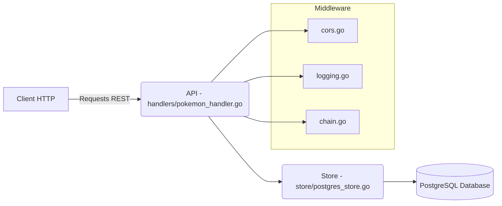

# Pokémon API

## Visão geral
Este repositório implementa uma API RESTful para gerenciamento de Pokémons, incluindo operações CRUD (criar, ler, atualizar, excluir) e paginação na listagem. O backend é desenvolvido em Go, utilizando PostgreSQL para armazenamento dos dados.

## Arquitetura

O servidor utiliza middlewares para CORS, logging e para encadear middlewares.

## Como rodar
### Pré-requisitos
- Go 1.25+
- PostgreSQL

### Passos
1. Configurar banco de dados PostgreSQL e aplicar o script de migração localizado em `migrations/001_create_pokemons.sql`.
2. Construir a aplicação:
```bash
go build -o server .
```
3. Rodar o servidor:
```bash
./server
```
4. O servidor escuta na porta 8080 por padrão.

Também há um `Dockerfile` configurado para build e execução do container.

## Configuração
- Conexão com banco (detalhes de conexão não encontrados, a confirmar).

## Principais fluxos/endpoints
| Método | Endpoint         | Descrição                       |
|--------|------------------|--------------------------------|
| GET    | /pokemons        | Lista pokémons com paginação   |
| GET    | /pokemons/{id}   | Obtém pokemon por ID            |
| POST   | /pokemons        | Cria novo pokemon              |
| PUT    | /pokemons/{id}   | Atualiza pokemon existente     |
| DELETE | /pokemons/{id}   | Remove pokemon                 |

Os dados são validados usando a biblioteca validator, garantindo campos obrigatórios e restrições específicas.

## Pontos de atenção
- Configurações de banco e variáveis de ambiente não documentadas.
- Autenticação e autorização não estão implementadas.
- Logs e CORS são tratados por middlewares genéricos.

---

Arquivos principais analisados:
- `internal/handlers/pokemon_handler.go`
- `internal/store/postgres_store.go`
- `internal/models/pokemon.go`
- `internal/validation/validator.go`
- `migrations/001_create_pokemons.sql`
- `Dockerfile`
- `internal/middleware/*.go`
