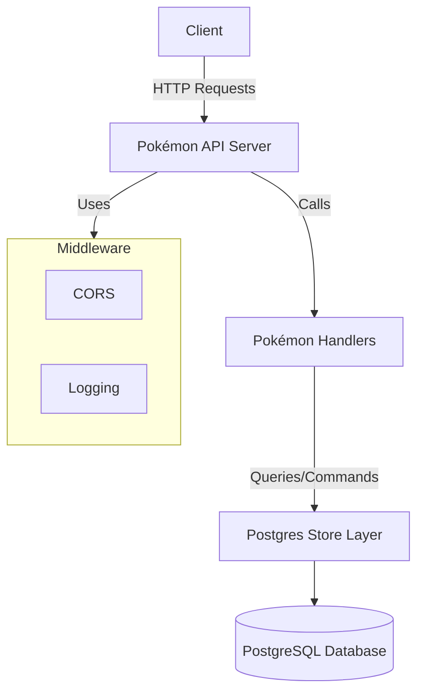

# Pokémon API

## Visão geral
Este repositório contém uma API REST para gerenciamento de pokémons. Implementada em Go, oferece operações CRUD para pokémons com atributos como nome, tipo, nível, HP e uma URL de foto. A API suporta paginação na listagem e validação dos dados de entrada.

## Arquitetura


## Como rodar
A aplicação é containerizada. Para construir e rodar:

```bash
# Build da imagem
docker build -t pokemon-api .

# Rodar container
docker run -p 8080:8080 pokemon-api
```

A aplicação escuta na porta 8080.

## Configuração
Configuração básica via string de conexão PostgreSQL para conectar ao banco (a confirmar, pois o entrypoint/main config não foi encontrado diretamente).

## Principais fluxos/endpoints
- `GET /pokemons` - Lista pokémons com paginação (query params `page`, `limit`)
- `GET /pokemons/{id}` - Obtém pokémon por ID
- `POST /pokemons` - Cria novo pokémon (validação aplicada)
- `PUT /pokemons/{id}` - Atualiza pokémon existente
- `DELETE /pokemons/{id}` - Remove pokémon

## Pontos de atenção
- Validação rigorosa dos campos (nome, tipo, nível, HP) usando a biblioteca `go-playground/validator`
- Middleware para CORS e logging de requisições implementados
- Manipulação dos erros cuidadosamente feita, retornando códigos HTTP apropriados
- SQL usa array para o tipo do pokémon
- Migration SQL para criação da tabela pokemons está em `migrations/001_create_pokemons.sql`
- A configuração da aplicação (como string de conexão e setup do servidor HTTP) não foi encontrada e deve ser confirmada

Arquivos principais:
- Handlers: `internal/handlers/pokemon_handler.go`
- Middleware: `internal/middleware/*.go`
- Modelos: `internal/models/pokemon.go`
- Store/Postgres: `internal/store/postgres_store.go`, `internal/store/db.go`
- Validação: `internal/validation/validator.go`
- Migration: `migrations/001_create_pokemons.sql`
- Dockerfile na raiz

---

## Resumo para Pull Request
Documentada API REST em Go para gerenciamento CRUD de pokémons, com paginação, validação e armazenamento em PostgreSQL. Documentação inclui principais arquivos, endpoints, arquitetura e uso do Docker. Ainda faltam detalhes da configuração da aplicação e entrypoint principal para execução do servidor, que devem ser confirmados posteriormente.